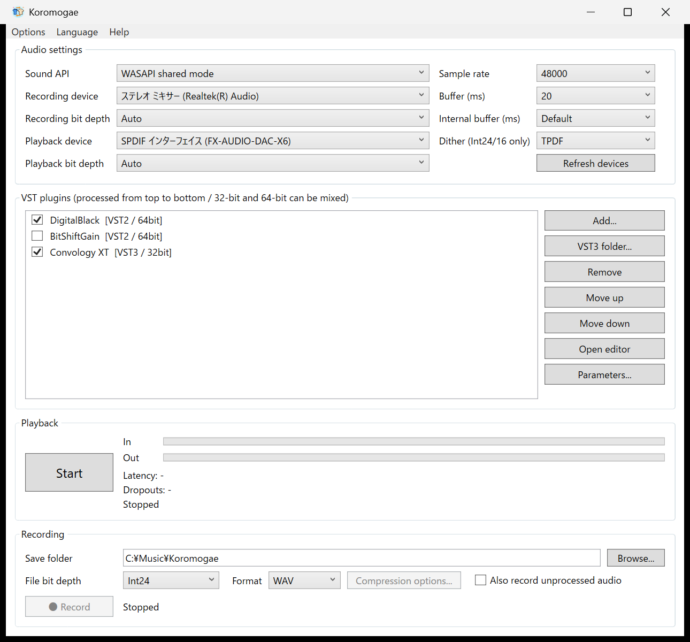
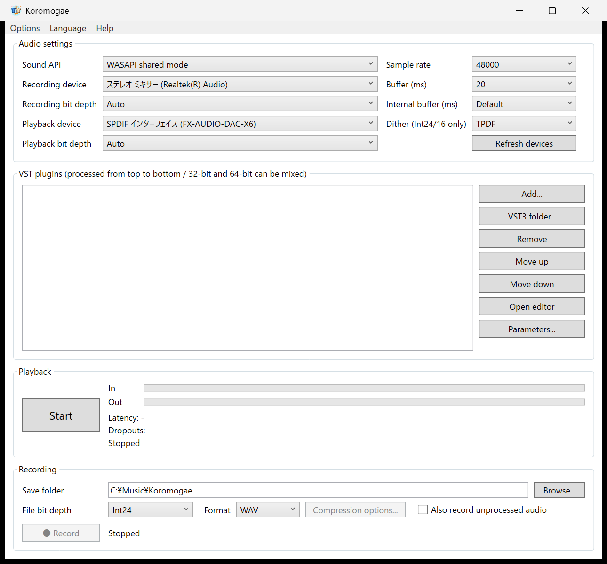
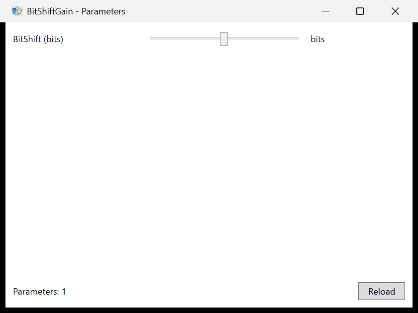
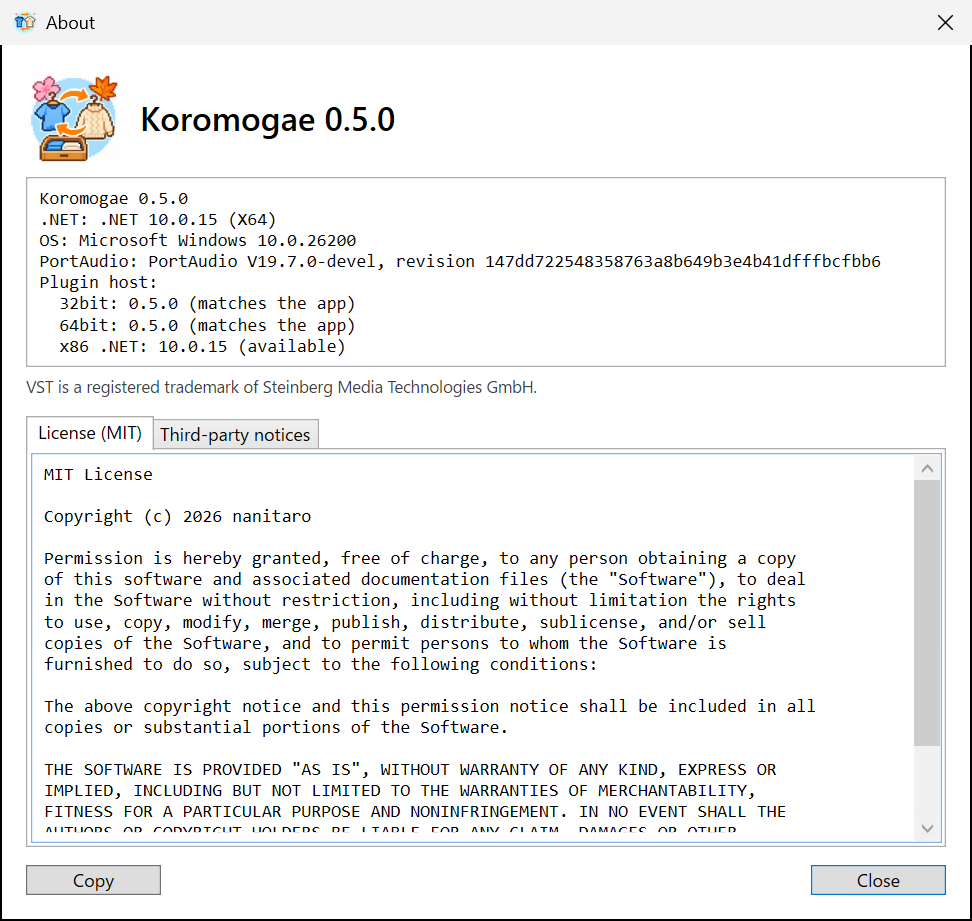

# Koromogae

**English** | [日本語](README.md)

A Windows app that routes an input (recording) device through a chain of VST®2/VST3 effect plugins (32-bit and 64-bit can be mixed) to an output (playback) device, in real time. Each plugin runs in its own process, so a crashing plugin does not take the app down. It can also record the processed (and optionally the unprocessed) sound to WAV or FLAC. Settings and logs can be kept next to the executable (portable mode). The screen is available in Japanese and English.

I wanted a simple program that takes the optical digital output of an MU2000 into a UW500, lets VST plugins process that sound, and sends it to a different sound device — so I made one.



## Contents

- [Features](#features)
- [Requirements](#requirements)
- [Quick start](#quick-start)
- [Features in detail](#features-in-detail)
  - [Audio input and output](#audio-input-and-output)
  - [VST plugins](#vst-plugins)
  - [Dither](#dither)
  - [Meters, latency and diagnostics](#meters-latency-and-diagnostics)
  - [Recording](#recording)
  - [Task tray](#task-tray)
  - [Startup arguments](#startup-arguments)
  - [Only one copy at a time](#only-one-copy-at-a-time)
  - [Language menu](#language-menu)
  - [Help menu](#help-menu)
- [Settings reference](#settings-reference)
- [Where settings and logs are saved / portable mode](#where-settings-and-logs-are-saved--portable-mode)
- [Troubleshooting](#troubleshooting)
- [Known limitations](#known-limitations)
- [For developers](#for-developers)
- [License](#license)

## Features

- **Real-time processing**: recording device → chain of VST plugins (processed from top to bottom) → playback device.
- **Five sound APIs**: WASAPI exclusive / WASAPI shared / Kernel streaming (WDM-KS) / DirectSound / MME.
- **VST2 and VST3** (audio effects). **32-bit and 64-bit plugins can be mixed.**
- **One process per plugin**: if a plugin crashes, the app and the other plugins keep running (the crashed plugin is marked "* Plugin host stopped" and the sound passes through).
- **Dither** (TPDF / HP-TPDF / noise shaping): reduces the distortion introduced when rounding to 24-bit / 16-bit integers.
- **Recording**: saves the processed sound (and optionally the unprocessed sound) as WAV (Float32 / Int24 / Int16) or FLAC (lossless).
- **Diagnostics**: shows the number of dropouts, the actual latency, device XRUNs and so on, to help find the cause of problems.
- **Task tray**: minimizing puts the app in the notification area (turn on "Minimize to the system tray" in the "Options" menu; it is off by default, which is the normal Windows minimize). Right-click the icon to start or stop playback and recording.
- **Startup arguments**: `--minimized` starts minimized in the tray (a minimized window appears for a moment at startup), `--start` starts playback automatically. Useful for running at Windows startup.
- **Portable mode**: put a marker file next to the executable and settings and logs are saved in that folder.
- **Japanese and English screens**, chosen from the Language menu.

Signal flow:

```
Recording device ─▶ Input meter
    │
    ├─▶ Dither / rounding ─▶ Unprocessed recording (optional)
    ▼
VST plugin 1 ─▶ 2 ─▶ … (top to bottom; a disabled plugin is bypassed)
    │
    ├─▶ Dither / rounding ─▶ Processed recording (optional)
    ▼
Output meter ─▶ Dither / rounding ─▶ Playback device
```

Dither / rounding is done separately for playback and for recording: playback is converted to the playback device's format, and each recording to the "File bit depth" (both use the "Dither" setting; Float32 is not rounded, and 32-bit integer gets no dither).

## Requirements

- **Windows** (x64). Developed and tested on Windows 11.
- **.NET 10 Desktop Runtime (x64)**. Used by the app (`Koromogae.exe`) and the 64-bit plugin host.  
  Where to get it: the [.NET 10 download page](https://dotnet.microsoft.com/download/dotnet/10.0) (".NET Desktop Runtime", Windows x64).
- **Microsoft Visual C++ Redistributable (x64, the latest v14)**. The bundled `portaudio.dll` uses `vcruntime140.dll` from it. It is not bundled.  
  Where to get it: Microsoft's [Latest Supported Visual C++ Redistributable Downloads](https://learn.microsoft.com/cpp/windows/latest-supported-vc-redist) page.
- **To use 32-bit plugins, the x86 .NET 10 runtime is also required.** It is used by the 32-bit plugin host (the x64 runtime does not work for it). It is on the same download page (choose Windows x86).
  If it is missing, loading a 32-bit plugin makes the host exit right after starting, and the error says that the x86 .NET 10 runtime is required.
- The .NET runtime is not bundled. Get it from Microsoft's .NET download page.

## Quick start

1. Start `Koromogae.exe`.
2. Choose the **Sound API**, the **Recording device** and the **Playback device**. "WASAPI shared mode" is the easiest to begin with.
   (The device lists show the devices of the selected sound API. After plugging or unplugging a device, press "Refresh devices".)
3. To use VST plugins, press **"Add..."** and choose a `.dll` (VST2) or a `.vst3` (VST3). Folder-style VST3 bundles are added with "VST3 folder...".
   Plugins are processed from top to bottom ("Move up" / "Move down" reorder them).
4. Press **"Start"** and the sound flows. The input/output meters, latency and diagnostics are shown.
5. Press **"Stop"** to stop. Settings and plugin states are saved when you close the app (and when you change a setting from "Options" or "Language" in the menu bar) and restored at the next start.



From top to bottom, the window has the groups "Audio settings", "VST plugins", "Playback" and "Recording". The menu bar has "Options", "Language" and "Help", from left to right.

## Features in detail

### Audio input and output

**Sound API** (only the devices of the selected one are listed):

| Choice | Rule of thumb (general characteristics) |
|---|---|
| WASAPI exclusive mode | Low latency. It takes the device exclusively, so other apps cannot play sound. |
| WASAPI shared mode (default) | Can be used together with other apps. Easy and usually stable. |
| Kernel streaming (WDM-KS) | Low latency. Only on devices that support it. |
| DirectSound / MME | Old APIs. High compatibility. |

**Sample rate**: 44100 / 48000 (default) / 88200 / 96000 / 176400 / 192000 Hz.

**Buffer (ms)**: 0 / 5 / 10 / **20 (default)** / 30 / 50 / 100 / 200 / 300 / 400 / 500.
Larger values make dropouts less likely and add latency. **0 means "the minimum of that API"**, which is not practical with some APIs and devices
(with DirectSound the input becomes silent; with MME the device drops audio).
With **WASAPI exclusive at 300 ms or more**, the sound stops on some output devices (the diagnostics line turns red and shows "Output callback has stopped").

**Internal buffer (ms)**: extra headroom added to the buffer between input and output. **Default** (no extra) / +5 / +10 / +20 / +30 / +40 / +50 / +100.
Try this first when you get dropouts. The extra amount becomes latency as it is (rule of thumb: +50 for DirectSound at 100 ms).

**Sample format** ("Recording bit depth" / "Playback bit depth", set separately for input and output): Auto / Float32 / Int32 / Int24 / Int16.
Auto uses the first format that opens, in the order Float32 → Int32 → Int24 → Int16. **If you pick one, only that format is tried** and an error is shown if it cannot be opened
(it does not fall back to Auto). With WASAPI shared, the OS mixer format takes priority, so you may not get exactly the format you picked.

After "Start", the sound API, devices, sample rate, buffer, internal buffer, sample formats, dither and "Refresh devices" cannot be changed. Stop first.

### VST plugins

- **VST2 and VST3 audio effects** are supported (instruments and MIDI are not). The limit is **64 plugins** (entries that could not be loaded at start and are kept in the settings count too).
- The checkbox on the left of each row switches **enabled / bypass** (pass-through).
- **Open editor** (or double-clicking a row) opens the plugin's own window. Plugins without an editor (such as Airwindows) open a
  **generic parameter window** (sliders). "Parameters..." opens it too.
- Plugins with two or more **built-in presets** get a "Presets" menu in the menu bar of the editor window.
- The **state** of each plugin (knob positions and so on) is saved when you close the app and restored at start.
- You can add, remove and reorder plugins even after "Start".



If some plugins **could not be restored at start**, you are told once, in a single dialog. Entries whose file no longer exists are removed from the settings,
and so are entries that exist but failed to load 3 times in a row (the others are kept so that they are tried again next time).

**Process isolation**: each plugin runs in its own process (the plugin host). A 32-bit host or a 64-bit host is used depending on the plugin's bitness.
If a plugin crashes, the app keeps running and only that plugin is bypassed (it is not restarted automatically).

### Dither

Noise added when rounding to 16-bit / 24-bit integers, to turn quantization distortion into uncorrelated noise.
It works **only for Int24 / Int16** (not for Float32 / Int32). The same mode is used for playback and recording.

| Mode | Characteristics and when to use |
|---|---|
| **TPDF** (default) | Standard. Turns the rounding error into white noise that does not depend on the signal. Recommended if you will edit or master the audio later. |
| **HP-TPDF** | Same distribution, with the noise shifted toward high frequencies. The total amount of noise is the same as TPDF. |
| **Noise shaping** | Reduces noise in the easily audible midrange (especially 3–4 kHz) and moves it to high frequencies (total noise increases). The effect is largest at 88.2 kHz and above. |
| **Off** | Rounding only. |

### Meters, latency and diagnostics

Shown in the "Playback" group.

- **In / Out meters**: turn red on clipping (input at 0.9999 or more, output above 1.0) and hold for 0.3 s so that you do not miss it.
- **Latency**: an estimate of the end-to-end latency, broken down into input + internal buffer + plugins + output (latency inside the device itself, such as USB devices, is not included).
- **Diagnostics**: numbers for investigating the cause of dropouts. These four are always shown:
  - **Dropouts**: times the buffer ran empty and the sound went silent (cumulative since start).
  - **Discarded**: share of audio discarded because too much had accumulated (cumulative since start).
  - **Headroom**: the current value.
  - **Device XRUN**: input/output overflows and underflows reported by the devices (cumulative since start).

  These three are added to the end of the line **only when a fault happens** (they are not shown otherwise):
  - **Callback exceptions N**: exceptions raised inside the audio processing (cumulative since start).
  - **Input/Output callback has stopped (N s)**: shown only while the callback has been stopped for 1.5 seconds or more; it disappears when the callback resumes.
  - **Recording lost N ms**: the length filled with silence because writing could not keep up (for the current recording, or the last one).

  **Red**: dropouts turn the line red for 3 seconds after the count increases. A callback stop is red only while it lasts. Callback exceptions stay red until you stop playback. Lost recording stays red until you start the next recording or stop playback.

  **Log**: exceptions, callback stops and lost recording are written to `app.log` once when they happen. When you stop playback after dropouts or faults, information for investigating the cause is also written.

### Recording

While running (after "Start"), "● Record" saves the **processed sound** (after the plugins). If you check "Also record unprocessed audio", the
**unprocessed sound** is also saved to a separate file (`…_dry`).

- **Format**: **WAV** (Float32 / Int24 (default) / Int16) or **FLAC** (Int24 / Int16; lossless, the sound is exactly the same).
  Float32 cannot be chosen with FLAC. "Compression options..." for FLAC selects the compression level 0–8 (default 5). Higher levels make smaller files but use more CPU while recording.
- **Save folder**: default is `Music\Koromogae`. You can paste a path; a folder that does not exist is created when recording starts.
- **File name**: `yyyyMMdd-HHmmss` + extension. Existing files are **never overwritten** (`-2` is added if names collide).
- **Long recordings**: a WAV file switches to the next numbered file (`_002`) as it nears about 4 GB (the sound continues across the break). FLAC has no such limit, so it is not split.
- **Write safety**: the header is written as soon as the file is opened and rewritten every second, so the file is playable up to just before a crash (at most about one second is lost).
  When free disk space falls under 500 MB, the status of the "Recording" group shows "* Disk space is running low". Under 20 MB (or on a write error) **only the recording** is stopped; playback continues and the audio so far can be read. If there is less than 20 MB when you start recording, the recording does not start.
  When writing cannot keep up, the lost length is filled with silence so the file length stays in step with real time, and "Recording lost" appears in the diagnostics.
- While recording, the save folder, format, compression options, bit depth and "Also record unprocessed audio" cannot be changed. Pressing "Stop", or closing the window, ends the recording too.
- **Plugin latency is not compensated.** The processed recording is delayed by the plugin latency, exactly as you heard it.

### Task tray

Turn on **"Minimize to the system tray"** (**off by default**) in the "Options" menu (Alt+O) of the menu bar and **minimizing** the window removes its taskbar button and puts an icon in the notification area (the task tray). On Windows 11 the icon may be inside the hidden icons (^). When it is off, minimizing is the normal Windows behavior (the taskbar button stays, and editors are not closed). The setting is saved as soon as you choose it. What follows describes the behavior when it is on.

- Minimizing also **closes every open editor (including the parameter window)**. What was open is not remembered.
- **Clicking** the icon (or "Restore" in its right-click menu) brings back **the main window only**, in the state it had before minimizing (normal size and position, or maximized). Editors that were closed are not reopened.
- The startup argument `--minimized` **always uses the tray**, whatever this setting is (minimizing after startup follows the setting).
- **Right-clicking** the icon offers the following. The audio, plugin and recording settings stay exactly as they were on the screen before minimizing.
  - **Restore**
  - **Start playback / Stop playback**
  - **Start recording / Stop recording**: greyed out unless playback is running.
  - **Exit**: the same as closing the window (the recording is finished and the settings are saved).
- If starting or recording fails while minimized, a balloon notification is shown instead of a message box.

### Startup arguments

Start `Koromogae.exe` with arguments to start minimized in the tray, or to start playback automatically. **The two are independent**, and you can give both. They are not case-sensitive, and `-minimized` / `/minimized` also work in place of `--minimized`. Abbreviations (such as `--min`) and words without a leading symbol (`minimized`) are treated as unknown arguments.

- **`--minimized`**: Starts **minimized to the tray**. Only the notification-area icon remains (restore it from the icon). It uses the tray whatever the "Minimize to the system tray" setting is. However, **for a moment at startup a minimized window (a taskbar button) appears** before it is put in the tray.
- **`--start`**: **Starts playback automatically** once the app is up, with the saved settings (sound API, devices, sample rate, buffer, formats, dither, plugins), exactly as if you had pressed "Start" (if a saved device is not found, the default device of that API is used). Playback begins after the plugins are restored. Recording is not started.

Notes:

- Example: put `"C:\Tools\Koromogae\Koromogae.exe" --minimized --start` in the "Target" of a startup shortcut (`shell:startup`) and the app stays in the tray and starts playback as soon as Windows starts.
- If playback cannot be started while minimized (for example the device cannot be opened), or for the warnings at startup, a **balloon notification** is shown instead of a message box (the details are also written to `app.log`). The app keeps running, so you can start playback by hand from the tray menu.
- Right after Windows starts, the audio devices may not be ready yet and `--start` may fail (it is not retried automatically).
- Unknown arguments are ignored (a warning is written to `app.log`). The restart after changing the language with "Language" does not carry the arguments over.

### Only one copy at a time

Only **one Koromogae that uses the same data folder** (the folder of the settings file and the log) can run at a time. If you start it while it is already running, the second one exits at once and brings the running window to the front (restoring it if it is in the tray or minimized). Arguments given to the second one (`--minimized` / `--start`) are ignored.

- The check is **per data folder**. **Portable copies in different folders can run together** (their data folder is the app folder). A normal copy without the marker (`%APPDATA%\Koromogae`) and a portable copy also have different data folders, so they can run together.
  However, a portable copy whose folder is not writable saves to `%APPDATA%\Koromogae` (see "Portable mode" below), so it cannot run together with a normal copy.
- Running several copies at once makes them compete for the same audio device (with WASAPI exclusive, the one that starts playback later may fail).

### Language menu

"Language" (Alt+L) in the menu bar (right of "Options") selects the language of the screen. It has three items: "**自動 (Windows の設定) / Auto**", "**日本語**" and "**English**".
Auto uses Japanese when the Windows display language is Japanese and English otherwise.
The menu title always contains the word "Language", and its items are always written the same way (they are not translated), so you can find it in any language.

- The choice (when it differs from the current language) is saved at once, and a dialog offers to **restart** the app. The new language takes effect after a restart.
- The log file (`app.log`) is always written in Japanese, whatever the screen language.
- The buttons of message boxes (OK / Yes / No) and the file dialogs follow the Windows display language, so they may differ from the app's language.

### Help menu

"Help" (Alt+H) in the menu bar (right of "Language").

- **Open manual** (Alt+H → M): opens `manual.ja.html` / `manual.en.html` (in the app's folder) in your default browser. The one for the screen language is preferred; the other is used if it is missing. If neither exists, you are told so.
- **About**: shows the version, the versions of .NET, the OS and PortAudio, whether the plugin hosts (32-bit / 64-bit) match the app's version,
  whether the x86 .NET runtime (needed for 32-bit plugins) is present, the VST trademark notice, and the full license texts (the "License (MIT)" and "Third-party notices" tabs). "Copy" sends content you can use in a bug report (the versions and environment; the licenses are not included) to the clipboard.
- **Open log and settings folder**: opens the folder containing `app.log` and `settings.json` in Explorer.



## Settings reference

The items on the screen and the saved settings (`settings.json`). The default is the value used when no setting exists or it is broken.

| Item (screen) | Choices | Default |
|---|---|---|
| Sound API | WASAPI exclusive / WASAPI shared / Kernel streaming / DirectSound / MME | WASAPI shared |
| Recording device / Playback device | Devices available with the selected API | Previous choice (if not found, the default device of that API) |
| Sample rate | 44100 / 48000 / 88200 / 96000 / 176400 / 192000 | 48000 |
| Buffer (ms) | 0 / 5 / 10 / 20 / 30 / 50 / 100 / 200 / 300 / 400 / 500 | 20 |
| Internal buffer (ms) | Default / +5 / +10 / +20 / +30 / +40 / +50 / +100 | Default (no extra) |
| Recording bit depth (input format) | Auto / Float32 / Int32 / Int24 / Int16 | Auto |
| Playback bit depth (output format) | Auto / Float32 / Int32 / Int24 / Int16 | Auto |
| Dither | TPDF / HP-TPDF / Noise shaping / Off | TPDF |
| Recording: Save folder | Any folder | `Music\Koromogae` |
| Recording: File bit depth | Float32 / Int24 / Int16 (Float32 is not available for FLAC) | Int24 |
| Recording: Format | WAV / FLAC | WAV |
| Recording: FLAC compression level | 0–8 | 5 |
| Recording: Also record unprocessed audio | On / Off | Off |
| Minimize to the system tray ("Options" in the menu bar) | On / Off | Off |
| Language (menu bar) | Auto / 日本語 / English | Auto |
| VST plugins | Up to 64. Path, enabled / disabled, state | (none) |

The settings file is always validated when loaded; out-of-range values are corrected to the defaults (the corrections are written to `app.log` and you are told at start).
A file that cannot be read, is broken (including values of the wrong type) or is too large is moved to `settings.json.bak` and the app starts with all defaults (so that the original data is not lost by the save at exit). `settings.json.bak` is overwritten each time, so only the latest one is kept.

## Where settings and logs are saved / portable mode

By default they are saved in **`%APPDATA%\Koromogae`**.

| File | Content |
|---|---|
| `settings.json` | Settings and plugin states |
| `app.log` | Log. When it exceeds 1 MB it is renamed to `app.log.old` and a new one is started. Plugin host errors are appended to the same file. |

**Portable mode**: put a file named **`portable`** (or `portable.txt`; it **can be empty, and its content is not read**) in the same folder as `Koromogae.exe`, and
`settings.json` and `app.log` are saved in that folder. You can carry the whole folder around (for example on a USB stick).

- If the app folder is not writable (for example under Program Files), settings are saved in `%APPDATA%\Koromogae` and you are told so.
- Existing settings in `%APPDATA%` are not moved. Copy `settings.json` by hand if you need it.
- The save folder for recordings does not change in portable mode (you can change it on the screen).
- If the environment variable `KOROMOGAE_DATA_DIR` is set, that folder takes top priority (meant for automated tests).
- The environment variable `KOROMOGAE_LANG` (`ja` / `en`) forces the screen language, ahead of the Language menu (meant for tests and checks).

## Troubleshooting

| Symptom | Possible cause | What to do |
|---|---|---|
| Dropouts | Not enough headroom in the buffer or internal buffer | Raise "Internal buffer" to +10 → +20 … or enlarge the buffer. If "Device XRUN" in the diagnostics is 0, the problem is the buffer headroom, not the device. |
| With WASAPI shared, one dropout within the first seconds after starting | Small headroom while the callback timing wobbles a little | Setting "Internal buffer" to +10 made it disappear (measured). |
| With WASAPI exclusive and a large buffer, the sound stopped | Some output devices stop at 300 ms or more | Use 200 ms or less. The diagnostics show "Output callback has stopped". |
| With DirectSound at 0 ms, the input is silent | DirectSound does not deliver input callbacks at 0 ms | Enlarge the buffer (or use another API). |
| With MME at 0 ms, audio drops out | Extremely small callbacks that the device cannot keep up with | Enlarge the buffer (or use another API). |
| "Start" fails with an error (a message that includes a format) | The device cannot open the sample format you specified | Set the sample format to "Auto". WASAPI exclusive only accepts formats and rates the device supports. |
| A 32-bit plugin cannot be loaded | The x86 .NET 10 runtime is missing | Install the x86 runtime ("Help > About" shows whether it is present). |
| The plugin editor does not open | The plugin's own reason (unsupported, failed to initialize) | Look at `app.log` (the reason is recorded). If there is no editor, the parameter window opens. |
| "* Plugin host stopped" appears in the list | The plugin crashed | That plugin is bypassed. Remove it and add it again. |
| At start, "Some values in the settings file were corrected on load" appears | The settings file had out-of-range or broken values | What was corrected is in `app.log`. |
| Settings went back to the defaults | The settings file was broken | The original file is kept as `settings.json.bak` (only the latest one). |
| I want to report a bug | | Attach "Copy" from "Help > About" and `app.log` ("Help > Open log and settings folder"). |

## Known limitations

- **Only audio effects** are supported. Instruments (VSTi) and MIDI are not.
- VST3 `IMessage` / `IAttributeList` (message passing between the component and the controller) are implemented, but have not been checked with a real plugin that uses them (none of the VST3 plugins at hand do; they are covered by unit tests only).
- Recording does not compensate for plugin latency.
- **Enlarging the buffer can make dropouts more likely** (WASAPI exclusive at 100 ms, DirectSound and others; callbacks arrive differently depending on the API).
  Raising "Internal buffer" almost always fixes it.
- Playback in integer formats (Int16 / Int24 / Int32) has been checked only in unit tests, because all the real devices at hand open as Float32.
- The English screen has been checked by running the app with `KOROMOGAE_LANG=en` and by automated tests; it has not been run on an English edition of Windows.

## For developers

### Build and run

```powershell
dotnet build Koromogae.csproj          # builds the app + VstCore + the plugin hosts (32-bit / 64-bit) together
dotnet run --project Koromogae.csproj
```

- Requires the .NET 10 SDK (Windows).
- The output is in `bin\Debug\net10.0-windows\win-x64\`. Make sure **both** `PluginHost32\VstPluginHost.exe` and `PluginHost64\VstPluginHost.exe` were produced.
  At the end of the build, the same `VstPluginHost` project is published twice, for x86 and for x64 (both use the shared runtime).
- Code that launches the 32-bit plugin host removes the x64 `DOTNET_ROOT` that `dotnet run` / `dotnet test` pass to child processes
  (otherwise the x86 host loads the x64 `hostfxr.dll` and fails to start).
- **Distribution**: besides `Koromogae.exe` and its DLLs, ship the `en\` folders (the English resources: `en\Koromogae.resources.dll`, `en\VstCore.resources.dll`,
  and `PluginHost32\en\` / `PluginHost64\en\`). Without them the screen falls back to Japanese.

### Tests

```powershell
dotnet test tests\PluginHost.Tests\PluginHost.Tests.csproj   # all of PluginHost.Tests (also builds the app)
dotnet test tests\App.Tests\App.Tests.csproj                 # all of App.Tests = automated UI tests (needs an interactive desktop)

# run all 5 suites in turn
foreach ($p in 'Settings', 'PluginHost', 'Audio', 'Ui', 'App') { dotnet test "tests\$p.Tests\$p.Tests.csproj" }
```

Five xUnit projects:

| Project | Content |
|---|---|
| `PluginHost.Tests` | Input validation of the plugin-host protocol, process isolation (others survive a crash, no processes left behind), checks with real plugins (skipped when the paths do not exist) |
| `Settings.Tests` | Validation and saving of the settings file, where files are saved (including portable mode), `AppLog`, and localization (language resolution, completeness of the string tables, no hard-coded Japanese text) |
| `Audio.Tests` | Sample format conversion, dither, ring buffer (virtual-time simulation), recording (WAV / FLAC, verified by an independent decoder), diagnostics text |
| `Ui.Tests` | Screen decisions (diagnostics red, meters, settings mapping, plugin list labels, About text), and English output |
| `App.Tests` | **Actually launches** the app and drives it with UI Automation, in Japanese and in English. Saves to a temporary folder and never reads or writes the user's settings |

### Structure

Three projects. **Every plugin, 32-bit or 64-bit, is loaded into its own separate process (the plugin host).**
No plugin DLL is loaded into the app's process (so that a crash does not spread to the app or other plugins).

```
Koromogae (WPF, x64)  ─ UI, audio engine, settings, log, recording
   │  named pipe (control) + shared memory (audio blocks)
   ├─▶ VstPluginHost.exe (x86)  ─ hosts one 32-bit plugin   ┐ both use
   └─▶ VstPluginHost.exe (x64)  ─ hosts one 64-bit plugin   ┘ VstCore
VstCore ─ VST2/VST3 host implementation, and the app ⇄ host communication code
```

Audio is done by calling the bundled `portaudio.dll` directly via P/Invoke.

### Conventions

- The **version number** is in **one place only**: `Version` in the root `Directory.Build.props` (shared by the app, VstCore, both hosts and the tests).
- Source, XAML, csproj and Markdown files are **UTF-8 (with BOM) + CRLF** (`.editorconfig`).
- Ship **`LICENSE`** and **`THIRD-PARTY-NOTICES.md`** with a release (the build copies them to the output folder). The .NET runtime is not bundled.
- The build also puts the **manuals** next to `Koromogae.exe`: **`README.txt`** / **`README.en.txt`** (a short hand-written guide from `dist\`, readable in Notepad) and **`manual.ja.html`** / **`manual.en.html`** (these READMEs turned into one HTML file each with the images embedded; the "For developers" section is left out; made by `tools\ManualBuilder`).
  Editing a README or `docs\images` makes the next build regenerate the HTML. Keep the Japanese and English versions in step.
- **Localization**: every string shown on the screen lives in `Resources/Strings.resx` (Japanese) and `Resources/Strings.en.resx` (English), and VstCore's few user-visible messages in
  `VstCore/Resources/CoreStrings*.resx`. Add the Japanese and the English text together, and read them with `Loc.T` / `Loc.F` (or `{local:T Key}` in XAML).
  Log lines stay in Japanese. Tests check that both languages have every key with the same placeholders, and that no hard-coded Japanese text is left in the code.
- When you change a feature, or the choices or defaults of a setting, update the "Settings reference" and the like in this README (and in the Japanese `README.md`).

## License

Released under the MIT License. See [LICENSE](LICENSE) for details.

For the licenses of bundled components such as PortAudio, see [THIRD-PARTY-NOTICES.md](THIRD-PARTY-NOTICES.md).

**Trademark**: VST is a registered trademark of Steinberg Media Technologies GmbH. This application is not affiliated with, endorsed by, or sponsored by Steinberg Media Technologies GmbH.
