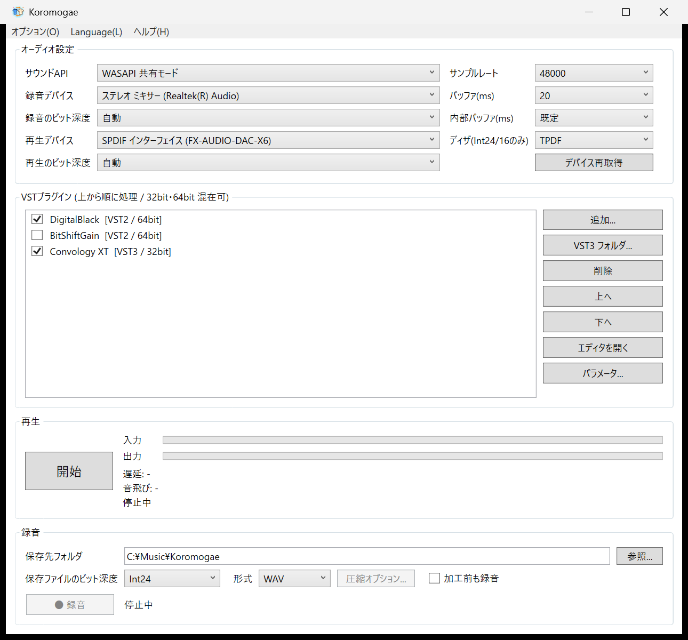
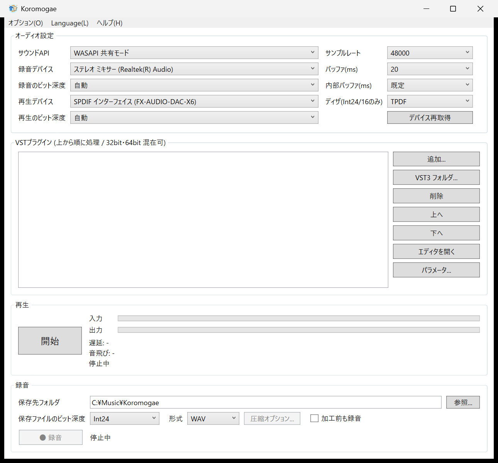
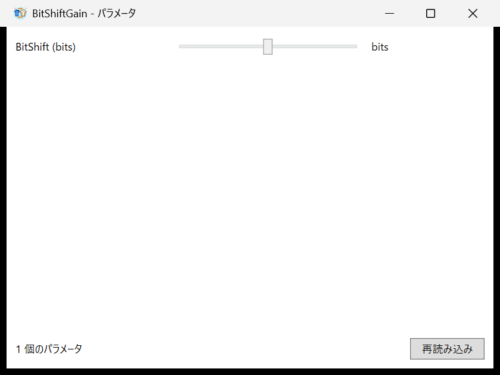
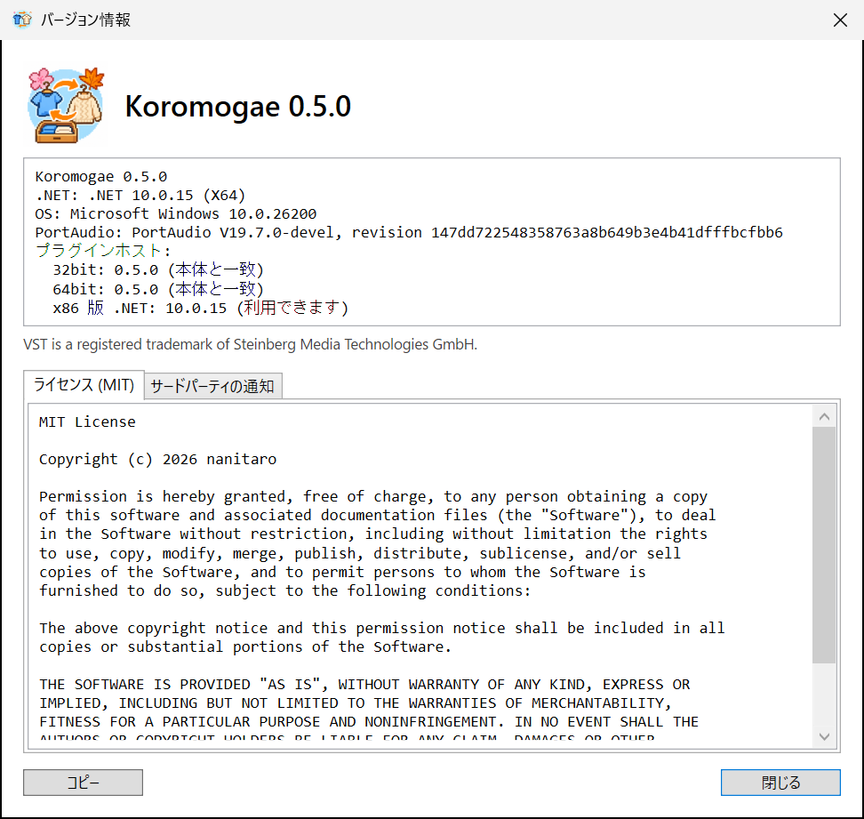

# Koromogae

[English](README.en.md) | **日本語**

*A Windows app that routes an input (recording) device through a chain of VST®2/VST3 effect plugins (32-bit and 64-bit can be mixed) to an output (playback) device, in real time. Each plugin runs in its own process, so a crashing plugin does not take the app down. It also records the processed (and optionally the unprocessed) sound to WAV or FLAC. Settings and logs can be kept next to the executable (portable mode). The screen is available in Japanese and English (see README.en.md).*

録音デバイスから入ってきた音を、VST2 / VST3 プラグイン (32bit / 64bit 混在可) に通して、別の再生デバイスへリアルタイムに出力する Windows 用のアプリです。

MU2000 の光デジタル出力を UW500 に入力し、そのサウンドを VST に処理させて、別のサウンドデバイスに出力させる、シンプルなプログラムが欲しかったので作りました。



## 目次

- [特長](#特長)
- [動作環境](#動作環境)
- [クイックスタート](#クイックスタート)
- [機能の説明](#機能の説明)
  - [音声の入出力](#音声の入出力)
  - [VST プラグイン](#vst-プラグイン)
  - [ディザ](#ディザ)
  - [メーター・遅延・診断](#メーター遅延診断)
  - [録音](#録音)
  - [タスクトレイ](#タスクトレイ)
  - [起動時の引数](#起動時の引数)
  - [二重起動](#二重起動)
  - [Language メニュー](#language-メニュー)
  - [ヘルプメニュー](#ヘルプメニュー)
- [設定項目の一覧](#設定項目の一覧)
- [設定とログの保存先 / ポータブルモード](#設定とログの保存先--ポータブルモード)
- [トラブルシューティング](#トラブルシューティング)
- [既知の制限](#既知の制限)
- [開発者向け](#開発者向け)
- [ライセンス](#ライセンス)

## 特長

- **リアルタイム処理**: 録音デバイス → VST プラグインのチェーン (上から順に処理) → 再生デバイス。
- **5 種類のサウンド API**: WASAPI 排他 / WASAPI 共有 / カーネルストリーミング (WDM-KS) / DirectSound / MME。
- **VST2 と VST3** (オーディオエフェクト)。**32bit と 64bit のプラグインを混在**して使えます。
- **プラグインごとに別プロセス**: プラグインが落ちても、本体や他のプラグインは落ちません (落ちたプラグインは「※プラグインホスト停止」と表示され、音はそのまま通ります)。
- **ディザ** (TPDF / HP-TPDF / ノイズシェイピング): 整数 (24bit / 16bit) へ丸めるときの歪みを減らします。
- **録音**: 加工後の音 (と、任意で加工前の音) を、WAV (Float32 / Int24 / Int16) または FLAC (可逆圧縮) で保存します。
- **診断**: 音飛びの回数・実際の遅延・デバイスの XRUN などを画面に出し、原因の切り分けに使えます。
- **タスクトレイ**: メニューバーの「オプション」で「最小化時にタスクトレイに格納する」をオンにすると、最小化したときに通知領域へ格納されます (既定はオフで、通常の最小化です)。アイコンの右クリックで、再生・録音の開始/停止もできます。
- **起動時の引数**: `--minimized` で最小化 (トレイ) で起動 (起動の一瞬だけ、最小化したウィンドウが現れます)、`--start` で自動で再生を開始します。Windows の起動時に常駐させるのに使えます。
- **ポータブルモード**: 目印のファイルを置くと、設定とログが本体のフォルダに保存されます。
- **日本語と英語の画面**: メニューバーの「Language」で切り替えられます (英語版の説明は [README.en.md](README.en.md))。

信号の流れ:

```
録音デバイス ─▶ 入力メーター
    │
    ├─▶ ディザ/丸め ─▶ 加工前の録音 (任意)
    ▼
VST プラグイン 1 ─▶ 2 ─▶ … (上から順。無効にすると素通し)
    │
    ├─▶ ディザ/丸め ─▶ 加工後の録音 (任意)
    ▼
出力メーター ─▶ ディザ/丸め ─▶ 再生デバイス
```

ディザ/丸めは、再生と録音でそれぞれ別に行います。再生は再生デバイスの形式に、録音は「保存ファイルのビット深度」に合わせます (方式は「ディザ」の設定を共通で使います。Float32 では丸めず、32bit 整数ではディザを付けません)。

## 動作環境

- **Windows** (x64)。Windows 11 で開発・確認しています。
- **.NET 10 デスクトップ ランタイム (x64)**。本体 (`Koromogae.exe`) と 64bit のプラグインホストが使います。  
  入手先: [.NET 10 のダウンロードページ](https://dotnet.microsoft.com/download/dotnet/10.0) (「.NET デスクトップ ランタイム」の Windows x64)。
- **Microsoft Visual C++ 再頒布可能パッケージ (x64。v14 系の最新版)**。同梱の `portaudio.dll` が、その中の `vcruntime140.dll` を使います。同梱はしていません。  
  入手先: [最新のサポートされている Visual C++ 再頒布可能パッケージ](https://learn.microsoft.com/cpp/windows/latest-supported-vc-redist)。
- **32bit のプラグインを使うときは、x86 版の .NET 10 ランタイム**も必要です。32bit のプラグインホストが使います (x64 版のランタイムでは動きません)。入手先は上と同じダウンロードページです (Windows x86 を選びます)。
  無い PC で 32bit プラグインを読み込むと、ホストが起動直後に終了して、エラーに「x86 版の .NET 10 ランタイムが必要」と出ます。
- .NET のランタイムは、同梱していません。Microsoft の .NET のダウンロードページから入手してください。

## クイックスタート

1. `Koromogae.exe` を起動します。
2. **サウンド API**、**録音デバイス**、**再生デバイス**を選びます。最初は「WASAPI 共有モード」が手軽です。
   (デバイス一覧は、選んだサウンド API のものです。デバイスを抜き差ししたら「デバイス再取得」を押します。)
3. VST プラグインを使うときは、**「追加...」** で `.dll` (VST2) か `.vst3` (VST3) を選びます。フォルダ形式の VST3 は「VST3 フォルダ...」です。
   複数を選ぶと、上から順に処理されます (「上へ」「下へ」で並べ替え)。
4. **「開始」** を押すと、音が流れます。入出力のメーターと、遅延・診断が表示されます。
5. **「停止」** で止めます。設定とプラグインの状態は、アプリを閉じるとき (と、メニューバーの「オプション」「Language」で設定を変えたとき) に保存され、次回の起動で復元されます。



画面は、上から「オーディオ設定」「VST プラグイン」「再生」「録音」のグループです。メニューバーには、左から「オプション」「Language」「ヘルプ」が並びます。

## 機能の説明

### 音声の入出力

**サウンド API** (選んだものの、デバイスだけが一覧に出ます):

| 選択肢 | 目安 (一般的な性質) |
|---|---|
| WASAPI 排他モード | 遅延が小さい。デバイスを独占するので、他のアプリの音は出ません。 |
| WASAPI 共有モード (既定) | 他のアプリと同時に使える。手軽で安定しやすい。 |
| カーネルストリーミング (WDM-KS) | 低遅延。対応しているデバイスだけ。 |
| DirectSound / MME | 古い API。互換性が高い。 |

**サンプルレート**: 44100 / 48000 (既定) / 88200 / 96000 / 176400 / 192000 Hz。

**バッファ (ms)**: 0 / 5 / 10 / **20 (既定)** / 30 / 50 / 100 / 200 / 300 / 400 / 500。
大きいほど音飛びしにくく、そのぶん遅延が増えます。**0 は「その API の最小」** で、API とデバイスによっては実用になりません
(DirectSound は入力が無音になり、MME はデバイス側で音が欠けます)。
**WASAPI 排他で 300 ms 以上**にすると、出力デバイスによっては音が止まります (画面の診断に「出力のコールバックが止まっています」と赤く出ます)。

**内部バッファ (ms)**: 入力と出力の間のバッファの余裕に、上乗せする量です。**既定** (上乗せなし) / +5 / +10 / +20 / +30 / +40 / +50 / +100。
音飛びが出るときに、まず試してください。上乗せしたぶん、そのまま遅延になります (目安: DirectSound の 100 ms なら +50)。

**サンプル形式** (「録音のビット深度」「再生のビット深度」。入力と出力で別々): 自動 / Float32 / Int32 / Int24 / Int16。
自動は、Float32 → Int32 → Int24 → Int16 の順に、開けた形式を使います。**指定したときは、その形式だけ**を試し、開けなければエラーにします
(自動には切り替えません)。WASAPI 共有では、OS のミキサーの形式が優先されて、指定どおりにならないことがあります。

「開始」の後は、サウンド API・デバイス・サンプルレート・バッファ・内部バッファ・サンプル形式・ディザ・「デバイス再取得」は、変えられません。いったん停止してください。

### VST プラグイン

- 対応は **VST2 と VST3 のオーディオエフェクト**です (楽器や MIDI は扱いません)。上限は **64 個**です (起動時に読み込めず、設定に残しているものも数えます)。
- 一覧の左のチェックで、**有効 / バイパス** (素通し) を切り替えます。
- **エディタを開く** (または一覧をダブルクリック) で、プラグイン自身の画面を開きます。エディタを持たないプラグイン (Airwindows など) は、
  **汎用のパラメータ画面** (スライダー) が開きます。「パラメータ...」でも開けます。
- **内蔵プリセット**が 2 つ以上あるプラグインは、エディタのウィンドウのメニューバーに「プリセット」が付きます。
- プラグインの**状態** (つまみの位置など) は、アプリを閉じるときに保存され、起動時に復元されます。
- 「開始」の後でも、プラグインの追加・削除・並べ替えができます。



**起動時に復元できなかったプラグイン**がある場合は、ダイアログに 1 回だけまとめて知らせます。ファイルが無いものは設定から外し、
ファイルはあるのに 3 回連続で読み込めなかったものも外します (それ以外は、次回に再び試すために残します)。

**プロセスの分離**: プラグインは、1 つにつき 1 つの別プロセス (プラグインホスト) で動きます。ビット数に合わせて、32bit 用と 64bit 用のホストを使い分けます。
プラグインが落ちても本体は落ちず、そのプラグインだけが素通しになります (自動では再起動しません)。

### ディザ

16bit / 24bit の整数へ丸めるときに、量子化の歪みを、無相関なノイズに変えるために加えるノイズです。
**Int24 / Int16 のときだけ**働きます (Float32 / Int32 では働きません)。再生と録音の両方に同じ方式が使われます。

| 方式 | 特徴・使いどころ |
|---|---|
| **TPDF** (既定) | 標準。丸め誤差を、信号に依存しない白色ノイズにします。後で編集やマスタリングをするなら、これがお薦めです。 |
| **HP-TPDF** | 同じ分布で、ノイズが高域に寄ります。全体のノイズ量は TPDF と同じです。 |
| **ノイズシェイピング** | 聞こえやすい中域 (特に 3〜4 kHz) のノイズを減らし、高域へ移します (全体のノイズは増えます)。88.2 kHz 以上では、特に効果が大きくなります。 |
| **オフ** | 四捨五入だけです。 |

### メーター・遅延・診断

「再生」のグループに表示されます。

- **入力 / 出力メーター**: クリップ (入力は 0.9999 以上、出力は 1.0 超え) すると赤くなり、見逃さないよう 0.3 秒保持します。
- **遅延**: 端から端までの遅延の目安です。入力 + 内部バッファ + プラグイン + 出力の内訳を出します (USB 機器など、デバイス内部の遅延は含みません)。
- **診断**: 音飛びの原因を調べるための数字です。次の 4 つは、いつも表示されます。
  - **音飛び**: バッファが空になって無音になった回数 (開始からの累計)。
  - **捨てた音**: 溜まりすぎて捨てた音の割合 (開始からの累計)。
  - **確保した余裕**: いまの値です。
  - **デバイス XRUN**: デバイスが報告した、入出力のオーバーフロー/アンダーフローの回数 (開始からの累計)。

  次の 3 つは、**異常が起きたときだけ**、行の末尾に追加されます (起きていなければ表示されません)。
  - **コールバックの例外 N 回**: 音声の処理の中で例外が起きた回数 (開始からの累計)。
  - **入力/出力のコールバックが止まっています (N 秒)**: 1.5 秒以上止まっている間だけ表示され、動き出すと消えます。
  - **録音の欠落 N ms**: 書き込みが追いつかず、無音で埋めた長さ (録音中のもの、または最後の録音のもの)。

  **赤の表示**: 音飛びは、増えた直後の 3 秒だけ赤です。コールバックの停止は、止まっている間だけ赤です。コールバックの例外は、再生を止めるまで赤のままです。録音の欠落は、次の録音を始めるか、再生を止めるまで赤のままです。

  **ログ**: 例外・停止・録音の欠落は、起きたときに 1 回、`app.log` に記録されます。再生を止めたときに、音飛びや異常があれば、原因の調査用の情報も記録されます。

### 録音

動作中 (「開始」の後) に、「● 録音」で、**加工後の音** (プラグインを通した後) を保存します。「加工前も録音」にチェックすると、
**加工前の音**も、別のファイル (`…_dry`) に残します。

- **形式**: **WAV** (Float32 / Int24 (既定) / Int16) または **FLAC** (Int24 / Int16。可逆圧縮で、音は完全に元どおりです)。
  FLAC では Float32 は選べません。FLAC の「圧縮オプション...」で、圧縮レベル 0〜8 (既定 5) を選びます。大きいほど小さくなりますが、録音中の CPU の負荷が増えます。
- **保存先**: 既定は `ミュージック\Koromogae` です。貼り付けて入力でき、存在しないフォルダは録音を始めるときに作ります。
- **ファイル名**: `yyyyMMdd-HHmmss` + 拡張子。既存のファイルは**上書きしません** (重なるときは `-2` を足します)。
- **長い録音**: WAV は約 4 GB に近づくと、連番 (`_002`) の次のファイルへ切り替えます (切れ目でも音は連続します)。FLAC は上限がないので、分割しません。
- **書き込みの安全**: ファイルは、開いたらすぐヘッダを書き、1 秒ごとに書き直すので、落ちても直前 (最大で約 1 秒前) まで再生できます。
  ディスクの空きが 500 MB 未満になると、録音のグループの状態表示に「※ディスクの空きが少なくなっています」と出ます。20 MB 未満 (または書き込みの失敗) で**録音だけ**を止めます (再生は続きます。それまでの音は読めます)。録音を始めるときに 20 MB 未満なら、録音は始まりません。
  書き込みが追いつかないときは、捨てた長さを無音で埋めて、ファイルの長さが実時間とずれないようにし、診断に「録音の欠落」と出します。
- 録音中は、保存先・形式・圧縮オプション・ビット深度・加工前の録音の指定を変えられません。「停止」を押す、またはウィンドウを閉じると、録音も終わります。
- **プラグインの遅延は補正しません**。加工後の録音は、プラグインの遅延のぶん遅れて、聞こえたとおりに残ります。

### タスクトレイ

メニューバーの「オプション(O)」(Alt+O) にある **「最小化時にタスクトレイに格納する」** (**既定はオフ**) をオンにすると、ウィンドウを**最小化**したとき、タスクバーのボタンは消えて、通知領域 (タスクトレイ) にアイコンが出ます。Windows 11 では、「隠れているインジケーター」(^) の中に入ることがあります。オフのときは、Windows 標準の最小化です (タスクバーに残り、エディタも閉じません)。設定は、選んだ時点で保存されます。以下は、オンのときの動作です。

- 最小化と同時に、**開いていたエディタ (パラメータ画面を含む) はすべて閉じます**。何を開いていたかは覚えません。
- アイコンの**クリック** (または右クリックの「元に戻す」) で、**メインウィンドウだけ**が、最小化する前の状態 (通常の大きさと位置、または最大化) に戻ります。閉じたエディタは、開き直しません。
- 起動時の引数 `--minimized` は、この設定にかかわらず、**いつもトレイに格納します** (起動したあとの最小化は、設定に従います)。
- アイコンを**右クリック**すると、次の操作ができます。オーディオ・プラグイン・録音の設定は、最小化する前の画面の設定のままです。
  - **元に戻す**
  - **再生を開始 / 再生を停止**
  - **録音を開始 / 録音を停止**: 再生中でないときは、グレーアウトします。
  - **終了**: ウィンドウを閉じたときと同じです (録音を終え、設定を保存します)。
- 最小化中に開始や録音に失敗したときは、メッセージボックスの代わりに、バルーン通知でお知らせします。

### 起動時の引数

`Koromogae.exe` に引数をつけて起動すると、最小化 (トレイ) の状態で始めたり、自動で再生を始めたりできます。**2 つは独立**で、両方つけることもできます。大文字小文字は区別せず、`--minimized` の代わりに `-minimized` / `/minimized` とも書けます。省略した書き方 (`--min` など) や、先頭の記号が無いもの (`minimized`) は、知らない引数として扱います。

- **`--minimized`**: **最小化 (トレイ)** で起動します。通知領域のアイコンだけになります (アイコンから元に戻せます)。「最小化時にタスクトレイに格納する」の設定にかかわらず、トレイに格納します。ただし、**起動の一瞬だけ、最小化したウィンドウ (タスクバーのボタン) が現れて**、すぐトレイに格納されます。
- **`--start`**: 起動したら、**自動で再生を始めます**。保存されている設定 (サウンド API・デバイス・サンプルレート・バッファ・形式・ディザ・プラグイン) のまま、「開始」を押したのと同じです (保存したデバイスが見つからないときは、その API の既定のデバイスで始めます)。プラグインの復元が終わってから始めます。録音は始めません。

補足:

- 例: スタートアップのショートカット (`shell:startup`) の「リンク先」に `"C:\Tools\Koromogae\Koromogae.exe" --minimized --start` と書くと、Windows の起動時にトレイへ常駐して、すぐ再生を始めます。
- 最小化中に、再生を始められなかったとき (デバイスが開けないなど) や、起動時の警告は、メッセージボックスの代わりに**バルーン通知**でお知らせします (内容は `app.log` にも残ります)。アプリは起動したままなので、トレイのメニューから手動で開始できます。
- Windows の起動直後は、オーディオデバイスがまだ使えず、`--start` が失敗することがあります (自動の再試行はしません)。
- 知らない引数は無視します (`app.log` に警告を残します)。「Language」で言語を切り替えたあとの再起動では、引数は引き継ぎません。

### 二重起動

同じ保存先 (設定ファイルとログのフォルダ) を使う Koromogae は、**同時に 1 つしか起動できません**。すでに起動しているときにもう一度起動すると、2 つ目はすぐに終了して、起動中のウィンドウを前に出します (トレイに格納されている・最小化されているときは、元に戻します)。2 つ目につけた引数 (`--minimized` / `--start`) は無視されます。

- 判定は**保存先ごと**です。**別の場所にコピーしたポータブル版どうしは、同時に起動できます** (本体のフォルダが保存先のため)。目印のない通常版 (`%APPDATA%\Koromogae`) とポータブル版も、保存先が違うので、同時に起動できます。
  ただし、本体のフォルダに書き込めないポータブル版は `%APPDATA%\Koromogae` に保存するので (下記「ポータブルモード」)、通常版と同時には起動できません。
- 複数のコピーを同時に動かすと、同じ音声デバイスを取り合います (WASAPI 排他では、あとから再生を始めた方が失敗することがあります)。

### Language メニュー

メニューバーの「Language(L)」(Alt+L。「オプション」の右隣) で、画面の言語を選びます。項目は「**自動 (Windows の設定) / Auto**」「**日本語**」「**English**」の 3 つです。
自動は、Windows の表示言語が日本語なら日本語、それ以外は英語です。どの言語の画面でも見つけられるよう、見出しにはいつも「Language」の語が入り、項目はいつも同じ表記です (翻訳しません)。

- 選ぶと (いまと違う言語のとき)、すぐ保存され、**再起動するか**を確認するダイアログが出ます。新しい言語は、再起動すると反映されます。
- ログ (`app.log`) は、画面の言語にかかわらず、いつも日本語です。
- メッセージボックスのボタン (OK / はい / いいえ) と、ファイルを選ぶダイアログは、Windows の表示言語に従うので、アプリの言語と一致しないことがあります。

### ヘルプメニュー

メニューバーの「ヘルプ」(Alt+H。「Language」の右隣) にあります。

- **マニュアルを開く** (Alt+H → M): 配布物の `manual.ja.html` / `manual.en.html` (本体と同じフォルダ) を、既定のブラウザで開きます。画面の言語のものを優先し、無ければもう一方を開きます。どちらも無いときは、そのことをお知らせします。
- **バージョン情報**: 版番号、.NET・OS・PortAudio のバージョン、プラグインホスト (32bit / 64bit) の版が本体と一致しているか、
  x86 版 .NET の有無 (32bit プラグインに必要)、VST の商標の表示と、ライセンスの全文 (「ライセンス (MIT)」と「サードパーティの通知」のタブ) を表示します。「コピー」で、不具合の報告に使える内容 (版と環境。ライセンスは含みません) をクリップボードに送れます。
- **ログ・設定フォルダを開く**: `app.log` と `settings.json` のあるフォルダをエクスプローラーで開きます。



## 設定項目の一覧

画面の項目と、保存される設定です (`settings.json`)。既定値は、設定が無い・壊れているときの値です。

| 項目 (画面) | 選択肢 | 既定 |
|---|---|---|
| サウンド API | WASAPI 排他 / WASAPI 共有 / カーネルストリーミング / DirectSound / MME | WASAPI 共有 |
| 録音デバイス / 再生デバイス | 選んだ API で使えるデバイス | 前回の選択 (見つからなければ、その API の既定のデバイス) |
| サンプルレート | 44100 / 48000 / 88200 / 96000 / 176400 / 192000 | 48000 |
| バッファ (ms) | 0 / 5 / 10 / 20 / 30 / 50 / 100 / 200 / 300 / 400 / 500 | 20 |
| 内部バッファ (ms) | 既定 / +5 / +10 / +20 / +30 / +40 / +50 / +100 | 既定 (上乗せなし) |
| 録音のビット深度 (入力の形式) | 自動 / Float32 / Int32 / Int24 / Int16 | 自動 |
| 再生のビット深度 (出力の形式) | 自動 / Float32 / Int32 / Int24 / Int16 | 自動 |
| ディザ | TPDF / HP-TPDF / ノイズシェイピング / オフ | TPDF |
| 録音: 保存先フォルダ | 任意のフォルダ | `ミュージック\Koromogae` |
| 録音: 保存ファイルのビット深度 | Float32 / Int24 / Int16 (FLAC のとき Float32 は不可) | Int24 |
| 録音: 形式 | WAV / FLAC | WAV |
| 録音: FLAC の圧縮レベル | 0〜8 | 5 |
| 録音: 加工前も録音 | オン / オフ | オフ |
| 最小化時にタスクトレイに格納する (メニューバーの「オプション」) | オン / オフ | オフ |
| 言語 (メニューバーの「Language」) | 自動 / 日本語 / English | 自動 |
| VST プラグイン | 最大 64 個。パス・有効 / 無効・状態 | (なし) |

設定ファイルは、読み込むときに必ず検証し、範囲外の値は既定値に直します (直した内容は `app.log` に残り、起動時に知らせます)。
読めない・壊れている (型の合わない値を含む)・大きすぎるファイルは、`settings.json.bak` に退避して、すべて既定値で起動します (終了時の保存で、元のデータを失わないためです)。`settings.json.bak` は退避のたびに上書きされるので、残るのは最新の 1 つだけです。

## 設定とログの保存先 / ポータブルモード

既定では、**`%APPDATA%\Koromogae`** に保存します。

| ファイル | 内容 |
|---|---|
| `settings.json` | 設定とプラグインの状態 |
| `app.log` | ログ。1 MB を超えたら `app.log.old` に回して、新しく始めます。プラグインホストのエラーも、同じファイルに追記されます。 |

**ポータブルモード**: 本体 (`Koromogae.exe`) と同じフォルダに、**`portable`** (または `portable.txt`) という名前のファイル (**空でよく、中身は見ません**) を置くと、
`settings.json` と `app.log` が、そのフォルダに保存されます。フォルダごと (USB メモリなどへ) 持ち運べます。

- 本体のフォルダに書き込めないとき (Program Files など) は、`%APPDATA%\Koromogae` に保存して、その旨を知らせます。
- `%APPDATA%` にある既存の設定は、移しません。必要なら、`settings.json` を手でコピーしてください。
- 録音ファイルの保存先は、ポータブルモードでも変わりません (画面で変えられます)。
- 環境変数 `KOROMOGAE_DATA_DIR` を設定すると、そのフォルダが最優先になります (自動テスト用です)。
- 環境変数 `KOROMOGAE_LANG` (`ja` / `en`) を設定すると、「Language」の設定より優先して、画面の言語を固定します (テストや動作確認用です)。

## トラブルシューティング

| 症状 | 考えられる原因 | 対処 |
|---|---|---|
| 音飛びする | バッファや内部バッファの余裕が足りない | 「内部バッファ」を +10 → +20 … と増やす。バッファを大きくする。診断の「デバイス XRUN」が 0 なら、デバイスではなく、バッファの余裕の問題です。 |
| WASAPI 共有で、開始の数秒以内に 1 回だけ音が飛ぶ | 余裕が小さい状態で、コールバックの届き方が少し揺れる | 「内部バッファ」を +10 にすると、消えることを確認しています (実測)。 |
| WASAPI 排他で、大きなバッファにしたら無音になった | 出力デバイスによっては、300 ms 以上で止まる | バッファを 200 ms 以下にする。診断に「出力のコールバックが止まっています」と出ます。 |
| DirectSound で 0 ms にしたら、入力が無音 | DirectSound は、0 ms では入力のコールバックが来ない | バッファを大きくする (または別の API)。 |
| MME で 0 ms にしたら、音が欠ける | コールバックが極端に小さく、デバイスが追いつかない | バッファを大きくする (または別の API)。 |
| 「開始」でエラーになる (形式を含むメッセージ) | 指定したサンプル形式を、デバイスが開けない | サンプル形式を「自動」にする。WASAPI 排他は、デバイスが受け付ける形式・レートだけです。 |
| 32bit のプラグインを読み込めない | x86 版の .NET 10 ランタイムが無い | x86 版を入れる (「ヘルプ > バージョン情報」で有無が分かります)。 |
| プラグインのエディタが開かない | プラグインの都合 (非対応・初期化の失敗) | `app.log` を見る (開けない原因が記録されます)。エディタが無いときは、パラメータ画面が開きます。 |
| 一覧に「※プラグインホスト停止」と出た | プラグインがクラッシュした | そのプラグインは素通しになっています。削除して、追加し直してください。 |
| 起動時に「設定ファイルの一部を修正して読み込みました」と出た | 設定ファイルに、範囲外や壊れた値があった | 直した内容は `app.log` にあります。 |
| 設定が既定に戻った | 設定ファイルが壊れていた | `settings.json.bak` に、元のファイルが残っています (最新の 1 つだけ)。 |
| 不具合を報告したい | | 「ヘルプ > バージョン情報」の「コピー」と、`app.log` (「ヘルプ > ログ・設定フォルダを開く」) を添えてください。 |

## 既知の制限

- **オーディオエフェクトだけ**に対応します。楽器 (VSTi) や MIDI は扱いません。
- VST3 の `IMessage` / `IAttributeList` (コンポーネントとコントローラ間のメッセージ通信) は実装しましたが、これを使う実際のプラグインでは確かめていません (手元の VST3 は、どれも使いませんでした。単体テストだけで確認しています)。
- 録音は、プラグインの遅延を補正しません。
- **バッファを大きくすると、音飛びが出やすくなる**ことがあります (WASAPI 排他の 100 ms、DirectSound など。API によって、コールバックの届き方が違うためです)。
  「内部バッファ」を増やすと、ほぼ直ります。
- 整数形式 (Int16 / Int24 / Int32) での再生は、手元の実デバイスがすべて Float32 で開くため、単体テストでのみ確かめています。
- 英語の画面は、`KOROMOGAE_LANG=en` で起動した本体と自動テストで確かめています。英語版の Windows では実行していません。

## 開発者向け

### ビルドと実行

```powershell
dotnet build Koromogae.csproj          # 本体 + VstCore + プラグインホスト (32bit / 64bit) をまとめてビルド
dotnet run --project Koromogae.csproj
```

- 必要なもの: .NET 10 SDK (Windows)。
- 出力は `bin\Debug\net10.0-windows\win-x64\` です。`PluginHost32\VstPluginHost.exe` と `PluginHost64\VstPluginHost.exe` の**両方**が出力されていることを確認してください。
  ビルドの最後に、同じ `VstPluginHost` プロジェクトを、x86 と x64 の 2 通りに発行します (どちらも、共有ランタイムを使います)。
- 32bit のプラグインホストを実行するコードは、`dotnet run` / `dotnet test` が子プロセスへ渡す x64 用の `DOTNET_ROOT` を外します
  (x86 のホストが x64 の `hostfxr.dll` を読んで、起動に失敗するため)。

### テスト

```powershell
dotnet test tests\PluginHost.Tests\PluginHost.Tests.csproj   # PluginHost.Tests の全件 (本体のビルドも走ります)
dotnet test tests\App.Tests\App.Tests.csproj                 # App.Tests の全件 = 画面の自動テスト (対話的なデスクトップが必要)

# 全 5 スイートを順に実行する
foreach ($p in 'Settings', 'PluginHost', 'Audio', 'Ui', 'App') { dotnet test "tests\$p.Tests\$p.Tests.csproj" }
```

xUnit の 5 プロジェクトです。

| プロジェクト | 内容 |
|---|---|
| `PluginHost.Tests` | プラグインホストとの通信の入力検証、プロセス分離 (落ちても他は無事・プロセスが残らない)、実プラグインを使う確認 (パスに無ければスキップ) |
| `Settings.Tests` | 設定ファイルの検証と保存、保存先の決め方 (ポータブルモードを含む)、`AppLog`、多言語対応 (言語の決め方、文字列表が両言語で揃っていること、コードに日本語の文字列が残っていないこと) |
| `Audio.Tests` | サンプル形式の変換、ディザ、リングバッファ (仮想時間の模擬)、録音 (WAV / FLAC。独立した復号器で検証)、診断の文面 |
| `Ui.Tests` | 画面の判断 (診断の赤、メーター、設定項目の対応、プラグイン一覧の表記、バージョン情報の文面)、英語の表示 |
| `App.Tests` | 本体を**実際に起動**して、UI オートメーションで操作する (日本語と英語)。保存先は一時フォルダにして、利用者の設定は読み書きしない |

### 構成

3 つのプロジェクトです。**プラグインは、32bit / 64bit を問わず、1 つにつき 1 つの別プロセス (プラグインホスト) にロードします。**
本体のプロセスには、プラグインの DLL を読み込みません (落ちても、本体や他のプラグインに波及させないためです)。

```
Koromogae (WPF, x64)  ─ UI・オーディオエンジン・設定・ログ・録音
   │  名前付きパイプ (制御) + 共有メモリ (音のブロック)
   ├─▶ VstPluginHost.exe (x86)  ─ 32bit プラグインを 1 つ載せる   ┐ どちらも
   └─▶ VstPluginHost.exe (x64)  ─ 64bit プラグインを 1 つ載せる   ┘ VstCore を使う
VstCore ─ VST2/VST3 のホスト実装と、本体⇄ホストの通信コード
```

音声は、同梱の `portaudio.dll` を P/Invoke で直接呼びます。

### 規約

- **版番号**は、ルートの `Directory.Build.props` の `Version` の **1 か所だけ**です (本体・VstCore・両ホスト・テストに共通)。
- ソース・XAML・csproj・Markdown は **UTF-8 (BOM 付き) + CRLF** で統一しています (`.editorconfig`)。
- 配布物には、**`LICENSE`** と **`THIRD-PARTY-NOTICES.md`** を添えます (ビルドの出力先へコピーされます)。.NET ランタイムは同梱しません。
- **説明書**も、ビルドが出力先 (`Koromogae.exe` の隣) に作ります: **`README.txt`** / **`README.en.txt`** (`dist\` にある手書きの短い説明。メモ帳で読めます) と、**`manual.ja.html`** / **`manual.en.html`** (この README を、画像を埋め込んだ 1 ファイルの HTML にしたもの。「開発者向け」の節は除きます。`tools\ManualBuilder` が作ります)。
  この README か `docs\images` を直すと、次のビルドで HTML も作り直されます。日本語と英語は、同じ内容にそろえてください。
- **配布物には `en\` フォルダ** (英語の画面の資源: `en\Koromogae.resources.dll`、`en\VstCore.resources.dll`、`PluginHost32\en\`、`PluginHost64\en\`) も含めます。無いと、画面は日本語になります。
- **多言語対応**: 画面に出す文字列は、すべて `Resources/Strings.resx` (日本語) と `Resources/Strings.en.resx` (英語)、VstCore が利用者に見せる少数のメッセージは `VstCore/Resources/CoreStrings*.resx` にあります。
  日本語と英語を一緒に足し、`Loc.T` / `Loc.F` (XAML では `{local:T キー}`) で読みます。ログは日本語のままです。テストが、両言語にキーがあること・書式が同じこと・コードに日本語の文字列が残っていないことを確かめます。
- 機能や、設定の選択肢・既定値を変えたら、この README の「設定項目の一覧」なども直してください。

## ライセンス

MIT ライセンスです。詳しくは [LICENSE](LICENSE) を参照してください。

同梱している PortAudio などのライセンスは [THIRD-PARTY-NOTICES.md](THIRD-PARTY-NOTICES.md) を参照してください。

**商標**: VST is a registered trademark of Steinberg Media Technologies GmbH. (VST は Steinberg Media Technologies GmbH の登録商標です。)
本アプリは、同社とは関係がなく、同社が承認・提供するものではありません。
